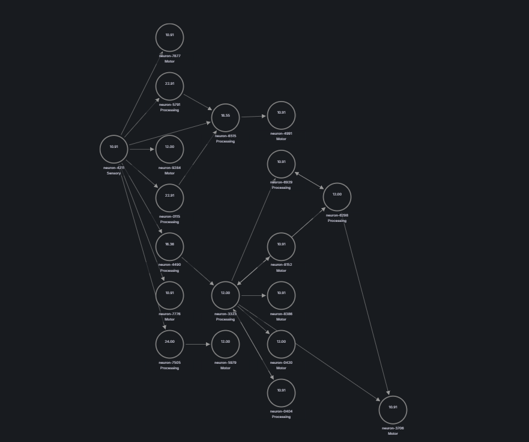
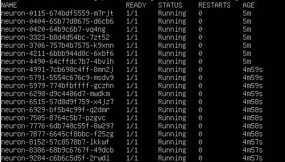
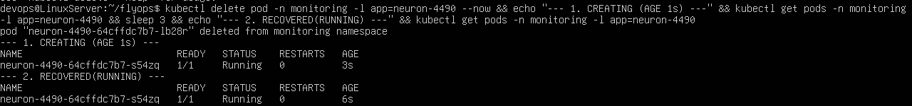
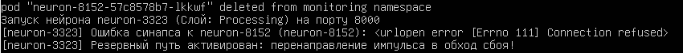

# FlyOps 2.0: Учебный микросервисный стенд в Kubernetes

[](https://kubernetes.io/)
[](https://prometheus.io/)
[](https://grafana.com/)
[](https://www.docker.com/)
[](https://www.python.org/)
[](LICENSE)

> [English version](README.en.md) | **Русская версия**

Практический проект для отработки навыков системного инжиниринга и DevOps: кластер из 19 взаимодействующих микросервисов внутри **Kubernetes (Minikube)**.

За основу топологии связей взята графовая структура нейронной цепочки (коннектом дрозофилы), что дает сложную, разветвленную сеть зависимостей. На этом стенде я исследовал и настроил ключевые механизмы отказоустойчивости, маршрутизации и мониторинга микросервисов.

---

## 🎯 Что реализовано и протестировано:

1. **Развертывание в Kubernetes:** 19 подов с независимыми ресурсами CPU/RAM, пробами `livenessProbe` / `readinessProbe` и сервисами через Kube-DNS / CoreDNS.
2. **Отказоустойчивость инфраструктуры (L4):** проверка реакции Kubernetes ReplicaSet при принудительном удалении пода (`kubectl delete pod`) — под автоматически пересоздается и возвращается в строй за 3 секунды.
3. **Отказоустойчивость приложения (L7 failover):** обработка ошибок сети (код `Errno 111 Connection refused`). Если соседний сервис недоступен, микросервис мгновенно перенаправляет запрос по резервному маршруту.
4. **Защита от перегрузки (Rate Limiting):** защита от шторма запросов с отсечением избыточного трафика кодом HTTP 429, предотвращающая падение нод по памяти (OOMKilled).
5. **Сбор метрик и мониторинг:** экспорт метрик в Prometheus через `ServiceMonitor` (CRD Prometheus Operator) и построение живого дашборда с топологией в **Grafana (Node Graph)**.

---

## 📐 Архитектура стенда

Каждый узел — это независимый Python-микросервис в Docker-контейнере. Узлы общаются напрямую через HTTP/REST по внутренним именам CoreDNS (`http://neuron-XX.flyops.svc.cluster.local:8080/stimulate`):

```
                         [ ВНЕШНИЙ ЗАПРОС / ТРИГГЕР ]
                                      |
                                      v
+=======================================================================================+
| ВХОДНОЙ СЛОЙ (Сенсоры / Ingress: Neuron 01-04)                                        |
+=======================================================================================+
                                      |
                                      v
+=======================================================================================+
| ПРОМЕЖУТОЧНЫЙ СЛОЙ (Маршрутизация и обработка: Neuron 05-14)                          |
|                                                                                       |
|   Основной путь: Neu-09 -> Neu-10 -> Neu-11 -> Neu-12                                 |
|                                                                                       |
|   Резервный путь (L7 Failover): при сбое узла -> Neu-13/14 -> альтернативный выход     |
+=======================================================================================+
                                      |
                                      v
+=======================================================================================+
| ВЫХОДНОЙ СЛОЙ (Исполнители / Output: Neuron 15-19)                                    |
+=======================================================================================+
```

<p align="center">
  
  <br>
  <em>Схема связей между микросервисами и маршруты передачи запросов.</em>
</p>

<p align="center">
  
  <br>
  <em>Состояние подов в namespace flyops: каждый микросервис работает изолированно.</em>
</p>

---

## 🛠️ Практические тесты отказоустойчивости (Chaos Testing)

### Тест 1. Падение пода под нагрузкой (L4 Self-Healing)
Проверяем работу оркестратора: принудительно убиваем ключевой узел сети и замеряем время восстановления:

```bash
kubectl delete pod -n flyops -l app=neuron-4490 --now && kubectl get pods -n flyops -l app=neuron-4490
```

**Результат:** Kubernetes моментально фиксирует несоответствие желаемого числа реплик и поднимает новый чистый под за **3 секунды**.

<p align="center">
  
  <br>
  <em>Лог терминала: уничтоженный под автоматически пересоздан и работает через 3 секунды.</em>
</p>

---

### Тест 2. Перемаршрутизация при сетевой ошибке (L7 Failover)
Удаляем промежуточный узел, на который прямо сейчас идут запросы:

```bash
kubectl delete pod -n flyops -l app=neuron-8152 --now
```

**Результат:** Вышестоящий сервис ловит ошибку сокета (`[Errno 111] Connection refused`) и, вместо того чтобы падать с ошибкой 500, переключается на запасной маршрут:

```python
async def forward_pulse(primary_target: str, fallback_target: str, payload: dict):
    try:
        async with aiohttp.ClientSession() as session:
            async with session.post(primary_target, json=payload, timeout=0.050) as resp:
                if resp.status == 200:
                    METRICS_FORWARDED.labels(status="success", route="primary").inc()
                    return await resp.json()
    except (asyncio.TimeoutError, aiohttp.ClientError):
        METRICS_FAILOVER.inc()
        # Переключение на резервный маршрут
        async with aiohttp.ClientSession() as session:
            async with session.post(fallback_target, json=payload, timeout=0.050) as resp:
                METRICS_FORWARDED.labels(status="success", route="fallback").inc()
                return await resp.json()
```

<p align="center">
  
  <br>
  <em>Терминал фиксирует перехват ошибки Errno 111 и успешную отправку по запасному пути.</em>
</p>

---

### Тест 3. Стресс-тест и ограничение нагрузки (Rate Limiter)
Имитируем шторм входящих запросов утилитой `hey` (100+ запросов в секунду):

```bash
hey -n 500 -c 10 -m POST \
  -H "Content-Type: application/json" \
  -d '{"stimulus": "hyper_burst", "amplitude": 1.0}' \
  http://$(minikube ip):$(kubectl get svc neuron-01 -n flyops -o jsonpath='{.spec.ports[0].nodePort}')/stimulate
```

**Результат:** Сервис пропускает 1 запрос в установленный интервал (400 мс), а избыточный паразитный флуд отсекает кодом `HTTP 429`. Процессор и память узла не перегружаются, кластер остается стабильным.

---

## 📊 Мониторинг и метрики (Prometheus & Grafana)

Каждый под отдает метрики в формате OpenMetrics на порту `:8080/metrics`:

| Метрика | Тип | Назначение |
| :--- | :--- | :--- |
| `flyops_spikes_received_total` | Counter | Количество входящих запросов на микросервис |
| `flyops_spikes_forwarded_total` | Counter | Успешно переданные запросы downstream |
| `flyops_refractory_drops_total` | Counter | Количество запросов, заблокированных рейт-лимитером |
| `flyops_l7_failover_events_total` | Counter | Количество переключений на резервные маршруты из-за недоступности сокета |
| `flyops_propagation_latency_seconds` | Histogram | Задержка сетевого ответа между сервисами |

Метрики собираются автоматически через `ServiceMonitor` и визуализируются в дашборде **Grafana Node Graph**, где отображаются активные связи и задержки.

---

## 🚀 Как запустить локально

### Требования:
- Linux (Ubuntu / Debian) или WSL2
- Docker, Minikube, kubectl, Helm v3+

### Запуск кластера и мониторинга:

```bash
# 1. Запуск Minikube с запасом ресурсов под поды и мониторинг
minikube start --cpus=4 --memory=8192 --disk-size=25g --driver=docker

# 2. Установка стека мониторинга (Prometheus Operator + Grafana)
helm repo add prometheus-community https://prometheus-community.github.io/helm-charts
helm repo update
helm install monitoring-stack prometheus-community/kube-prometheus-stack \
  --namespace monitoring --create-namespace \
  --set prometheus.prometheusSpec.serviceMonitorSelectorNilUsesHelmValues=false

# 3. Применение манифестов приложения
kubectl apply -f k8s/00-namespace.yaml
kubectl apply -f k8s/01-configmap-topology.yaml
kubectl apply -f k8s/02-neurons-sensory.yaml
kubectl apply -f k8s/03-neurons-inter.yaml
kubectl apply -f k8s/04-neurons-motor.yaml
kubectl apply -f k8s/05-servicemonitor.yaml

# 4. Проверка запуска подов
kubectl get pods -n flyops
```

---

## 📁 Структура проекта

```
FlyOps-2.0/
├── docs/                             # Скриншоты тестов и метрик
├── k8s/                              # Декларативные манифесты Kubernetes
│   ├── 00-namespace.yaml
│   ├── 01-configmap-topology.yaml
│   ├── 02-neurons-sensory.yaml
│   ├── 03-neurons-inter.yaml
│   ├── 04-neurons-motor.yaml
│   └── 05-servicemonitor.yaml
├── monitoring/
│   ├── grafana-nodegraph-dash.json   # Дашборд Grafana Node Graph
│   └── prometheus-rules.yaml         # Правила алертов Prometheus
├── src/
│   ├── app.py                        # Асинхронный HTTP-сервер микросервиса (aiohttp)
│   ├── config.py                     # Загрузка топологии и настроек
│   ├── metrics.py                    # Регистрация метрик Prometheus
│   └── Dockerfile                    # Сборка легковесного контейнера
├── scripts/
│   ├── stimulate.sh                  # Скрипт отправки тестовых запросов
│   └── chaos_kill_node.sh            # Скрипт симуляции падения подов
└── README.md
```

## Лицензия
MIT
